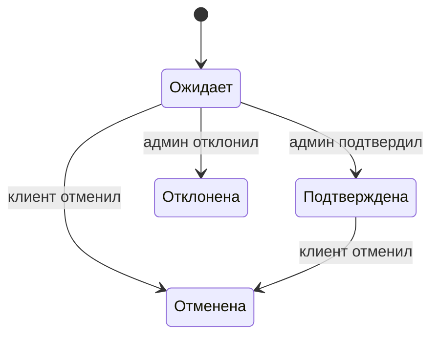

# SportBook

Веб-приложение для бронирования спортивных площадок: посетитель выбирает площадку, дату и свободный временной интервал, а администратор задаёт часы работы и ограничения, подтверждает заявки и видит календарь занятости.

> **Статус:** этап проектирования. Архитектура готова, код в разработке.

## Возможности (MVP)

- Регистрация и вход по email и паролю
- Список площадок с фото, описанием, видом спорта и ценой за час
- Выбор даты и свободного времени (занятые интервалы недоступны)
- Заявка на бронь с комментарием
- «Мои брони» со статусами и отмена брони до начала игры
- Календарь занятости площадок
- Панель администратора: площадки, часы работы, выходные дни, ограничения, подтверждение и отклонение заявок

## Роли

| Роль | Возможности |
|------|-------------|
| Гость | Смотреть площадки и календарь занятости, регистрироваться и входить |
| Клиент | Подавать заявки на бронь, видеть и отменять свои брони |
| Администратор | Управлять площадками и расписанием, задавать ограничения, подтверждать и отклонять заявки, видеть все брони |

## Стек

- **Фронтенд:** React (Vite)
- **Бэкенд:** Node.js, Express
- **База данных:** PostgreSQL
- **ORM** (работа с базой из кода): Prisma
- **Безопасность:** bcrypt (хеширование паролей), JWT (вход), Helmet, CORS

## Статусы брони



## Структура проекта

```
sportbook/
├── docs/
│   └── architecture.md      # Архитектура проекта
├── client/                  # Фронтенд (React + Vite)
├── server/                  # Бэкенд (Express + Prisma)
│   └── src/                 # routes → controllers → services → database
└── README.md
```

## Документация

Подробная архитектура: [docs/architecture.md](docs/architecture.md)

В документе описаны:

- роли, MVP и пользовательские истории
- бизнес-правила
- база данных (таблицы, связи, ER-диаграмма)
- API (эндпоинты с примерами запросов и ответов)
- страницы, структура папок, безопасность
- план расширения проекта

## Запуск

Инструкция по запуску будет добавлена после реализации проекта.
