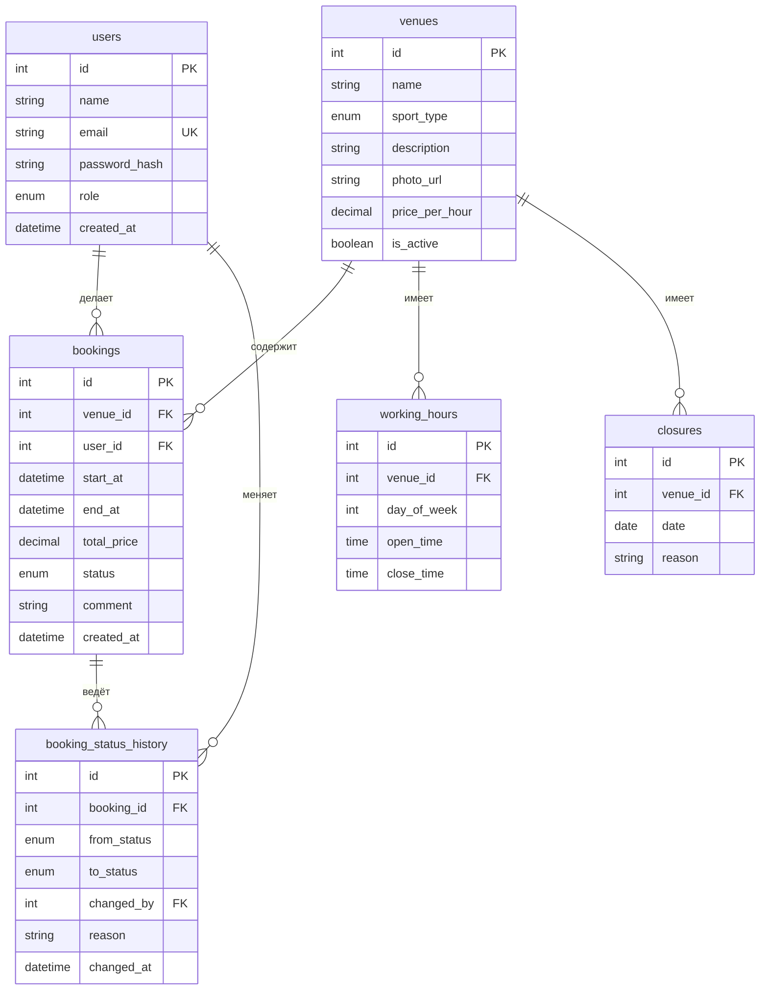

# SportBook — архитектура

Веб-система бронирования спортивных площадок.
Стек: React (Vite) + Node.js + Express + PostgreSQL + Prisma.

## 0. Принятые решения (допущения)

Эти решения приняты на старте. Если с чем-то не согласна, меняй здесь и пересматривай разделы ниже.

| Вопрос | Решение | Почему так |
|---|---|---|
| Одна организация или маркетплейс | Одна организация, несколько площадок | Не нужна роль «владелец» и разделение данных между владельцами. Для первой версии вдвое меньше правил доступа |
| Виды спорта | Футбол, баскетбол, теннис, волейбол. Одна площадка = один вид спорта | Если разрешить несколько видов на одной площадке, придётся делать связь «многие-ко-многим» и усложнять поиск. Сначала простой вариант |
| Оплата | Онлайн-оплаты нет, платят на месте. Сервер только считает цену | Платёжные системы требуют договоров и отдельной защиты. Для учебного проекта это лишний риск |
| Подтверждение брони | Админ подтверждает вручную | Так в твоём README: Ожидает → Подтверждена / Отклонена / Отменена |
| Длительность брони | От 1 до 3 часов, шаг 1 час | С шагом «1 час» слоты не дробятся на странные куски (например, 17:20–18:05), расписание проще проверять |
| Уведомления | В первой версии нет | Почта и Telegram требуют внешних сервисов. Статус клиент видит в личном кабинете |
| Роли | Гость, клиент, администратор | Минимум, которого хватает для бронирования |

---

## 1. Пользователи и роли

| Роль | Кто это | Что может |
|---|---|---|
| Гость | Не вошёл в систему | Смотреть список площадок, карточку площадки, календарь свободного времени. Регистрироваться и входить |
| Клиент | Зарегистрированный пользователь | Всё, что гость, плюс: создавать бронь, видеть только свои брони, отменять свои брони |
| Администратор | Сотрудник организации | Создавать и редактировать площадки, задавать часы работы, выходные и закрытия, подтверждать и отклонять заявки, видеть все брони |

**Почему так:** если не разделить роли, любой клиент сможет подтвердить свою бронь или удалить площадку.

---

## 2. MVP — минимальная первая версия

**Что входит:**
1. Регистрация и вход (email + пароль).
2. Список площадок с фильтром по виду спорта.
3. Карточка площадки с календарём свободного времени.
4. Создание брони клиентом.
5. Личный кабинет: мои брони, отмена брони.
6. Админ: создание и редактирование площадок.
7. Админ: часы работы, выходные и закрытия площадки.
8. Админ: список заявок, подтверждение и отклонение.

**Что НЕ входит и почему:**
- Онлайн-оплата: нужен платёжный сервис, это отдельный большой кусок работы.
- Уведомления (email, Telegram): нужны внешние сервисы, статус виден в кабинете.
- Отзывы и рейтинг площадок: не нужны для самой брони.
- Роль «владелец площадки»: в проекте одна организация.
- Загрузка нескольких фото площадки: хватит одного поля со ссылкой на фото.
- Повторяющиеся брони («каждый вторник»): сильно усложняют проверку пересечений.

**Почему так:** лучше довести до конца маленький рабочий проект с продуманными правилами, чем начать большой и не закончить.

---

## 3. Пользовательские истории

| № | История | MVP |
|---|---|---|
| U1 | Как гость, я хочу посмотреть список площадок, чтобы выбрать подходящую | Да |
| U2 | Как гость, я хочу отфильтровать площадки по виду спорта, чтобы быстрее найти нужную | Да |
| U3 | Как гость, я хочу видеть календарь свободного времени площадки, чтобы понять, когда можно прийти | Да |
| U4 | Как гость, я хочу зарегистрироваться, чтобы бронировать площадки | Да |
| U5 | Как клиент, я хочу войти в аккаунт, чтобы видеть свои брони | Да |
| U6 | Как клиент, я хочу забронировать площадку на выбранное время, чтобы занять его | Да |
| U7 | Как клиент, я хочу видеть список своих броней со статусами, чтобы знать, подтверждена ли бронь | Да |
| U8 | Как клиент, я хочу отменить бронь, чтобы освободить время, если планы изменились | Да |
| U9 | Как администратор, я хочу добавлять и редактировать площадки, чтобы клиенты видели актуальный список | Да |
| U10 | Как администратор, я хочу задать часы работы и выходные площадки, чтобы нельзя было бронировать в нерабочее время | Да |
| U11 | Как администратор, я хочу подтверждать или отклонять заявки, чтобы контролировать загрузку | Да |
| U12 | Как администратор, я хочу закрыть площадку на ремонт, чтобы клиенты не бронировали на эти даты | Да |
| U13 | Как клиент, я хочу изменить время брони, чтобы не отменять и не создавать заново | Нет |
| U14 | Как клиент, я хочу получать уведомление о подтверждении, чтобы не заходить на сайт | Нет |
| U15 | Как администратор, я хочу видеть историю изменений статуса брони, чтобы разбирать споры | Нет (таблица истории создаётся сразу, страницы нет) |

---

## 4. Бизнес-правила

Сервер проверяет все правила всегда. Браузер можно обойти (отправить запрос напрямую, отключить JavaScript), поэтому проверка только в браузере не защищает.

| № | Правило | Решение | Почему нельзя только в браузере |
|---|---|---|---|
| БП1 | Две брони на одну площадку не пересекаются по времени | Бронь A пересекается с бронью B, если начало A раньше конца B **и** конец A позже начала B. Проверка и создание брони идут в одной транзакции (операции выполняются как одно целое) с высоким уровнем изоляции. Если два клиента нажали одновременно, один получит успех, второй ошибку «время занято» | Календарь в браузере показывает данные на момент загрузки страницы. За это время другой клиент мог занять слот |
| БП2 | Бронь только в часы работы и не в выходной | Сервер смотрит часы работы по дню недели и таблицу закрытий по дате. Бронь целиком должна помещаться в рабочие часы | Клиент может подделать запрос и выбрать 3 часа ночи |
| БП3 | Длительность от 1 до 3 часов, шаг 1 час | Начало только на целый час (10:00, 11:00), конец = начало + целое число часов | Браузер можно обойти и отправить 45 минут или 10 часов |
| БП4 | Нельзя бронировать в прошлом и дальше чем на 30 дней вперёд | Сервер сравнивает начало брони с текущим временем сервера | У клиента на компьютере может стоять любая дата |
| БП5 | Отменить можно не позже чем за 2 часа до начала | Сервер сравнивает «начало брони минус 2 часа» с текущим временем | Кнопку «Отменить» в браузере можно показать или скрыть, а запрос отправить всё равно |
| БП6 | Цена считается на сервере: цена за час × часы. Сохраняется в брони в момент создания | Клиент цену не присылает. Если админ потом изменит цену площадки, старые брони не меняются | Если цену присылает браузер, клиент поставит себе 1 тенге |
| БП7 | Ожидающая бронь занимает время. Ждёт подтверждения 2 часа | Через 2 часа без ответа админа бронь автоматически получает статус «Отклонена» (причина «истекло время ожидания») и время освобождается. Проверка при каждом запросе к этой площадке, отдельный планировщик не нужен | Без этого клиент может «забронировать» всё расписание и никогда не подтверждаться |
| БП8 | Не больше 3 активных броней у клиента | Активные = «Ожидает» и «Подтверждена» с началом в будущем | Иначе один клиент займёт все слоты. Браузер не знает, сколько у клиента броней |
| БП9 | Площадку закрыли на ремонт | Нельзя создать закрытие на дату, где есть подтверждённые брони: сначала админ отменяет их с указанием причины. Ожидающие брони на эту дату автоматически отклоняются | Только сервер видит все брони и может гарантировать порядок действий |
| БП10 | Клиент видит и отменяет только свои брони | Сервер сравнивает id пользователя из токена с владельцем брони | Если проверять только в браузере, клиент подставит чужой номер брони в запрос |

**Почему так:** все правила записаны до кода, чтобы на защите на вопрос «что если…» был готовый ответ.

### Статусы брони

| Из статуса | В статус | Кто может | Условие |
|---|---|---|---|
| (нет) | Ожидает | Клиент | Выполнены БП1–БП4, БП8 |
| Ожидает | Подтверждена | Администратор | Время всё ещё свободно, не прошло 2 часа ожидания |
| Ожидает | Отклонена | Администратор | Причина обязательна |
| Ожидает | Отклонена | Система | Прошло 2 часа без ответа (БП7) или закрытие площадки (БП9) |
| Ожидает | Отменена | Клиент | Это его бронь, выполнено БП5 |
| Подтверждена | Отменена | Клиент | Это его бронь, выполнено БП5 |
| Подтверждена | Отменена | Администратор | Причина обязательна (например, ремонт) |
| Отклонена, Отменена | любой | Никто | Это конечные статусы, из них не выходят |

**Почему так:** если разрешить любые переходы, можно «оживить» отменённую бронь поверх уже занятого времени.

---

## 5. База данных

### Таблицы

**users**
| Поле | Тип | Примечание |
|---|---|---|
| id | Int, PK | автоинкремент |
| name | String | |
| email | String, unique | уникальный, в нижнем регистре |
| password_hash | String | хеш, не пароль |
| role | Enum (CLIENT, ADMIN) | по умолчанию CLIENT |
| created_at | DateTime | |

**venues** (площадки)
| Поле | Тип | Примечание |
|---|---|---|
| id | Int, PK | |
| name | String | |
| sport_type | Enum (FOOTBALL, BASKETBALL, TENNIS, VOLLEYBALL) | |
| description | String | |
| photo_url | String, nullable | |
| price_per_hour | Decimal | |
| is_active | Boolean | неактивная не показывается и не бронируется |

**working_hours** (часы работы)
| Поле | Тип | Примечание |
|---|---|---|
| id | Int, PK | |
| venue_id | Int, FK → venues | |
| day_of_week | Int (0–6) | 0 = понедельник |
| open_time | Time | |
| close_time | Time | |
| | | unique (venue_id, day_of_week) |

Если для дня недели строки нет, площадка в этот день не работает.

**closures** (выходные и закрытия)
| Поле | Тип | Примечание |
|---|---|---|
| id | Int, PK | |
| venue_id | Int, FK → venues | |
| date | Date | |
| reason | String | |
| | | unique (venue_id, date) |

**bookings** (брони)
| Поле | Тип | Примечание |
|---|---|---|
| id | Int, PK | |
| venue_id | Int, FK → venues | |
| user_id | Int, FK → users | |
| start_at | DateTime | время хранится в UTC |
| end_at | DateTime | |
| total_price | Decimal | считает сервер, БП6 |
| status | Enum (PENDING, CONFIRMED, REJECTED, CANCELLED) | |
| comment | String, nullable | |
| created_at | DateTime | |

Индекс по (venue_id, start_at, end_at): проверка пересечений идёт при каждой брони, индекс ускоряет её.

**booking_status_history** (история статусов)
| Поле | Тип | Примечание |
|---|---|---|
| id | Int, PK | |
| booking_id | Int, FK → bookings | |
| from_status | Enum, nullable | при создании пусто |
| to_status | Enum | |
| changed_by | Int, FK → users, nullable | пусто, если изменила система |
| reason | String, nullable | |
| changed_at | DateTime | |

### Связи

- Одна площадка → много часов работы (один-ко-многим).
- Одна площадка → много закрытий (один-ко-многим).
- Одна площадка → много броней (один-ко-многим).
- Один пользователь → много броней (один-ко-многим).
- Одна бронь → много записей истории (один-ко-многим).
- Связей «многие-ко-многим» нет. Брони связывают пользователей и площадки: это и есть «многие-ко-многим» через промежуточную таблицу.

### ER-диаграмма



### Проверка

- **Дублирование:** имя и email клиента хранятся только в `users`, в брони только `user_id`. Исключение сделано осознанно: `total_price` хранится в брони, хотя его можно посчитать. Иначе при смене цены площадки изменились бы все старые брони (БП6).
- **Расширение:** новые функции добавляются новыми таблицами (платежи, отзывы, уведомления), старые таблицы не меняются. Подробнее в разделе 10.

**Почему так:** отдельная таблица часов работы позволяет задавать разное время на разные дни. Если бы часы хранились полями `open_time` и `close_time` прямо в площадке, нельзя было бы сделать «в воскресенье до 18:00».

---

## 6. API

Все адреса начинаются с `/api`. Ответы в формате JSON. Ошибки: `400` (неверные данные), `401` (не вошёл), `403` (нет прав), `404` (не найдено), `409` (время занято).

| Метод | Адрес | Что делает | Доступ | История | Пример запроса → ответ |
|---|---|---|---|---|---|
| POST | /auth/register | Регистрация | Все | U4 | `{name, email, password}` → `201 {id, name, email}` |
| POST | /auth/login | Вход | Все | U5 | `{email, password}` → `200 {token, user}` |
| GET | /auth/me | Данные текущего пользователя | Клиент, админ | U5 | — → `200 {id, name, role}` |
| GET | /venues?sport=FOOTBALL | Список площадок, фильтр по спорту | Все | U1, U2 | — → `200 [{id, name, sport_type, price_per_hour}]` |
| GET | /venues/:id | Карточка площадки с часами работы | Все | U1 | — → `200 {id, name, description, working_hours}` |
| GET | /venues/:id/availability?date=2026-12-01 | Занятые и свободные слоты на дату | Все | U3 | — → `200 {date, slots: [{start, end, free}]}` |
| POST | /bookings | Создать бронь | Клиент | U6 | `{venue_id, start_at, hours, comment}` → `201 {id, status: "PENDING", total_price}` или `409 {error: "Время занято"}` |
| GET | /bookings/my | Мои брони | Клиент | U7 | — → `200 [{id, venue, start_at, end_at, status}]` |
| PATCH | /bookings/:id/cancel | Отменить свою бронь | Клиент (владелец) | U8 | — → `200 {id, status: "CANCELLED"}` или `400 {error: "Слишком поздно"}` |
| GET | /admin/bookings?status=PENDING | Все брони, фильтр по статусу | Админ | U11 | — → `200 [{id, client, venue, start_at, status}]` |
| PATCH | /admin/bookings/:id/confirm | Подтвердить заявку | Админ | U11 | — → `200 {id, status: "CONFIRMED"}` |
| PATCH | /admin/bookings/:id/reject | Отклонить заявку | Админ | U11 | `{reason}` → `200 {id, status: "REJECTED"}` |
| PATCH | /admin/bookings/:id/cancel | Отменить подтверждённую бронь | Админ | U12 | `{reason}` → `200 {id, status: "CANCELLED"}` |
| POST | /admin/venues | Создать площадку | Админ | U9 | `{name, sport_type, price_per_hour, ...}` → `201 {id}` |
| PUT | /admin/venues/:id | Изменить площадку | Админ | U9 | `{name, price_per_hour, is_active, ...}` → `200 {id}` |
| PUT | /admin/venues/:id/working-hours | Задать часы работы | Админ | U10 | `[{day_of_week, open_time, close_time}]` → `200` |
| POST | /admin/venues/:id/closures | Закрыть площадку на дату | Админ | U10, U12 | `{date, reason}` → `201 {id}` или `409 {error: "Есть подтверждённые брони"}` |
| DELETE | /admin/closures/:id | Убрать закрытие | Админ | U10 | — → `204` |

**Почему так:** адреса админа отделены префиксом `/admin`. Так проще одной проверкой закрыть доступ ко всем админским действиям.

---

## 7. Страницы

**Гость:**
- `/` — главная со списком площадок и фильтром.
- `/venues/:id` — карточка площадки и календарь.
- `/login` — вход.
- `/register` — регистрация.

**Клиент (дополнительно):**
- `/venues/:id/book` — форма бронирования (или окно на карточке).
- `/my-bookings` — мои брони с кнопкой «Отменить».

**Администратор:**
- `/admin` — панель: количество заявок, ожидающих ответа.
- `/admin/bookings` — список всех броней с подтверждением и отклонением.
- `/admin/venues` — список площадок.
- `/admin/venues/new` и `/admin/venues/:id/edit` — форма площадки.
- `/admin/venues/:id/schedule` — часы работы и закрытия.

**Карта переходов:**
```
Главная → Карточка площадки → (не вошёл) → Вход → Карточка → Форма брони → Мои брони
Главная → Регистрация → Вход → Главная
Вход (админ) → /admin → Брони / Площадки → Форма площадки / Расписание
```

**Почему так:** страницы админа лежат под одним адресом `/admin`. React скрывает их от клиента, но настоящую защиту делает сервер: без роли ADMIN API вернёт `403`.

---

## 8. Структура папок

```
sportbook/
├── client/                  # React (Vite)
│   └── src/
│       ├── pages/           # страницы
│       ├── components/      # кнопки, карточки, календарь
│       ├── api/             # функции запросов к серверу
│       └── context/         # хранение текущего пользователя
├── server/
│   ├── prisma/              # schema.prisma и миграции
│   └── src/
│       ├── routes/          # адреса
│       ├── controllers/     # приём запроса и ответ
│       ├── services/        # бизнес-правила
│       ├── middleware/      # проверка токена и роли
│       └── database/        # подключение Prisma
├── docs/
│   └── architecture.md
├── .env.example
├── .gitignore
└── README.md
```

| Слой | За что отвечает |
|---|---|
| routes | Связывает адрес с нужной функцией и подключает проверки доступа |
| controllers | Берёт данные из запроса, вызывает сервис, возвращает ответ или ошибку |
| services | Здесь живут все бизнес-правила БП1–БП10 |
| database | Единственное место, где код общается с PostgreSQL через Prisma |

**Почему так:** если правила лежат в контроллерах, они расползаются по коду, и одно из них забывают проверить в новом эндпоинте. В `services` каждое правило записано один раз.

---

## 9. Безопасность

- **Пароли:** в базе хранится только хеш (результат необратимого шифрования), например через bcrypt. Сам пароль нигде не сохраняется и не пишется в логи. *Почему так:* при утечке базы пароли нельзя прочитать.
- **Вход (JWT):** после проверки пароля сервер выдаёт токен (подписанную строку с id пользователя и ролью, срок жизни 1 день). Клиент присылает его в заголовке `Authorization: Bearer ...`. Сервер проверяет подпись. *Почему так:* без токена сервер не знает, кто делает запрос.
- **`.env`:** хранит `DATABASE_URL`, `JWT_SECRET`, `PORT`. В репозиторий попадает только `.env.example` с пустыми значениями, а `.gitignore` (с точкой) скрывает настоящий `.env`. *Почему так:* если `JWT_SECRET` утечёт, любой сможет выдать себе токен админа.
- **Проверки доступа (две ступени):**
  1. Есть ли валидный токен (`401`, если нет).
  2. Подходит ли роль (`403`, если нет) и принадлежит ли бронь этому клиенту.
- **Проверка входных данных:** сервер проверяет формат email, длину пароля (от 8 символов), даты и числа. *Почему так:* иначе в базу попадёт мусор.
- **Защита от подделки:** id пользователя берётся из токена, а не из тела запроса. Цена считается на сервере.
- **Ошибки:** при неверном входе всегда одно сообщение «Неверный email или пароль», без уточнения, что именно не так.
- **Первый админ:** создаётся отдельным скриптом или вручную в базе, а не через регистрацию. Иначе любой зарегистрируется админом.

---

## 10. Расширение

| Функция | Что придётся изменить | Риск переписывания |
|---|---|---|
| Онлайн-оплата | Добавить таблицу `payments` (бронь, сумма, статус платежа), новый статус брони «Ожидает оплаты», новый сервис оплаты и эндпоинт получения ответа от платёжной системы | Средний |
| Уведомления (email, Telegram) | Добавить сервис уведомлений, который вызывается при смене статуса брони | Низкий, если заложить сразу (см. ниже) |
| Владельцы площадок (маркетплейс) | Добавить в `venues` поле `owner_id`, роль OWNER, и проверку «владелец управляет только своими площадками» везде, где сейчас проверка «админ» | **Высокий**, если не заложить сейчас |

**Что сделать сейчас, чтобы не переписывать:**
- **Уведомления:** все смены статуса брони делать через **одну функцию** в `services`, которая заодно пишет историю. Тогда уведомление добавляется в одно место, а не в десять.
- **Владельцы:** сразу добавить в `venues` поле `owner_id` (ссылка на `users`). В первой версии там всегда админ. Проверки доступа писать как «может ли пользователь управлять этой площадкой», а не «пользователь админ». Тогда переход на владельцев меняет одну проверку, а не весь код.
- **Оплата:** `status` брони сделать enum (список значений), чтобы добавить новое значение было просто, и хранить `total_price` в брони (уже сделано, БП6).

---

## Вопросы на защите

**1. Что будет, если два клиента одновременно нажмут «Забронировать» на одно и то же время?**
Сервер проверяет пересечение и создаёт бронь в одной транзакции. Первый запрос проходит, второй видит занятое время и получает `409 «Время занято»`. Календарь в браузере для этого не годится: он показывает данные на момент загрузки страницы.

**2. Почему цена считается на сервере, а не в браузере?**
Всё, что приходит из браузера, можно подделать. Если клиент сам присылает цену, он поставит 1 тенге. Сервер берёт цену площадки из базы и умножает на часы, затем сохраняет в брони, чтобы последующая смена цены не изменила старые брони.

**3. Зачем нужна таблица `booking_status_history`, если статус уже есть в `bookings`?**
В `bookings` виден только текущий статус. История показывает, кто, когда и почему изменил статус (например, «админ отклонил, причина: ремонт»). Это нужно для разбора споров и для будущих уведомлений.

**4. Чем отличаются коды 401 и 403?**
`401`: сервер не знает, кто ты (нет токена или он неверный). `403`: сервер знает, кто ты, но у тебя нет прав (клиент пробует открыть админский адрес или чужую бронь).

**5. Почему слои routes → controllers → services → database, а не весь код в одном файле?**
У каждого слоя одна задача. Правила лежат в `services` в одном экземпляре, поэтому их нельзя забыть в новом эндпоинте. Если сменить базу, меняется только слой database. Если сменить способ входа, меняются только routes и middleware.
